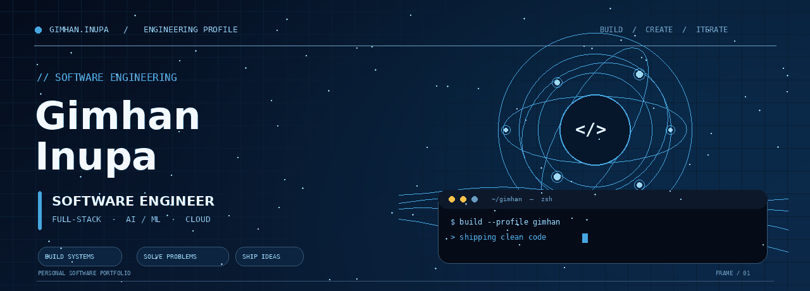
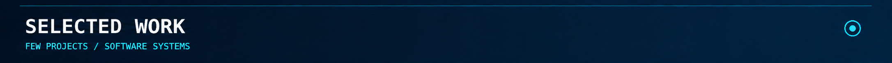
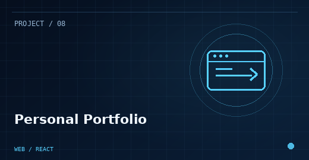
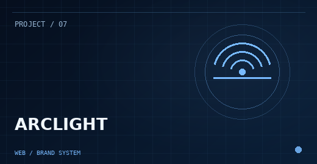
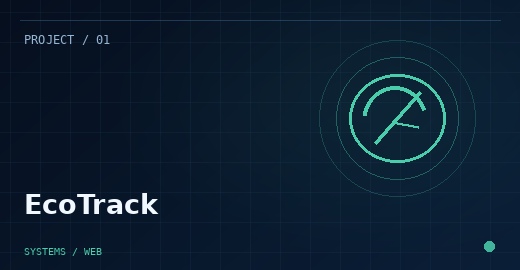
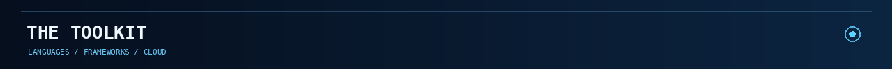
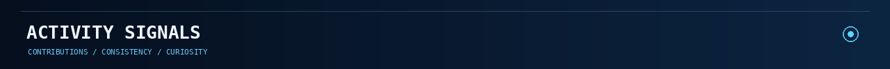

 

  

---

  

&nbsp;
&nbsp;

  

---

  

  

  

---

  

  

---

### BUILD WITH INTENTION. SHIP WITH PURPOSE.

<a href="https://github.com/gimhaninupa">GITHUB</a> &nbsp;·&nbsp; <a href="https://www.linkedin.com/in/gimhan-inupa-samaraweera-199233375/">LINKEDIN</a> &nbsp;·&nbsp; <a href="https://gimhan-inupa-portfolio.vercel.app/">PORTFOLIO</a>

  

